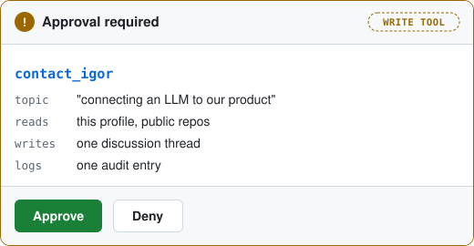
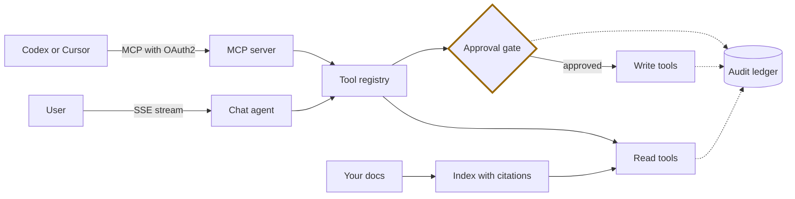

# Igor Vladyka

I build the layer that lets LLMs act on real systems without acting unsupervised, with an audit trail for every action.

<picture>
  <source media="(prefers-color-scheme: dark)" srcset="assets/approval-card-dark.svg">
  
</picture>

**[Approve](https://github.com/Igor-Vladyka/Igor-Vladyka/discussions/new?category=general)** opens a discussion thread on this repo. **[Deny](https://github.com/Igor-Vladyka?tab=repositories)** goes to my repositories.

## Adding an LLM to a product that already exists

One tool registry, three doors (chat, external agents, approvals) and one ledger that records every call. The approval gate in the diagram is the card above.

## The rules

| Block | The rule |
| --- | --- |
| Tool registry | One definition per tool. Chat and MCP both read from it, so they never drift. |
| MCP server | OAuth2 per user. Never a shared key. |
| Approval gate | Reads run freely. Every write waits for a person, and the wait survives a resume. |
| Audit ledger | Every tool call, approval and denial is recorded once and never edited, with who, what and when. Compliance reads the ledger, not chat logs. |
| Index | An answer points at a file and a passage. A wrong citation fails a test. |

## Also learned

- Tool errors go back to the model as structured results it can recover from, never as stack traces.
- Mask sensitive values before they reach the model provider, not after.
- Stream the answer as it is produced. Buffering hides every failure until the end.

Your system has a different shape? Approve the card above and tell me which block breaks.
